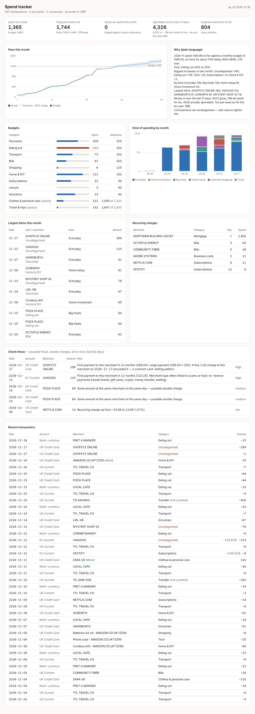

# multibank-spend-tracker: a customisable spending tracker for UK + EU (multi-bank, multi-currency) accounts, built for AI agents

[](https://github.com/zilun-lin/multibank-spend-tracker/actions/workflows/test.yml)


> **TL;DR.** This pulls bank accounts from several countries (Chase UK, Amex UK, Starling, Revolut, EU high-street banks and anything that exports CSV) into **one Google Sheet** for free or nearly free. It then **categorises every transaction with your own rules**, nets refunds against the original purchase, itemises online orders from **email receipts**, budgets lumpy spending (clothes, flights) **yearly instead of monthly**, **spreads yearly bills** (ground rent, insurance) across months, **sets tax aside on side income** so you see what's actually spendable, **watches for fraud and double charges**, and **forecasts month end with a range**. Claude, ChatGPT or any MCP client can then answer *"why am I over budget?"* and *"can I afford this?"* from live data. It runs on Google Sheets plus Apps Script with no server, and has no dependencies.

**Keywords:** personal finance · budget tracker · expense categoriser · fraud and duplicate-charge detection · side-income / freelancer tax set-aside · amortised yearly bills · open banking · Google Sheets bank sync · GoCardless/Nordigen alternative · Enable Banking · Lunch Flow · Revolut · Chase UK · multi-currency budgeting · refunds · receipts · MCP server · Agent Skills · Claude · ChatGPT



*Synthetic sample data. Open [`demo/index.html`](demo/index.html) locally for the interactive version.*

## Questions this repo answers

| If you're asking… | Start here |
|---|---|
| How do I track spending across UK and EU bank accounts in one place? | [recipe](docs/recipes/multi-country-spending-tracker.md) |
| How do I get Chase UK or Amex UK transactions into Google Sheets automatically? | [recipe](docs/recipes/uk-banks-to-google-sheets.md) |
| How do I connect Revolut or EU banks to Google Sheets for free? | [recipe](docs/recipes/eu-banks-revolut-to-google-sheets-free.md) |
| What replaces GoCardless Bank Account Data / Nordigen? | [recipe](docs/recipes/gocardless-nordigen-alternative.md) |
| How do I auto-categorise transactions with my own rules? | [recipe](docs/recipes/auto-categorise-transactions-rules.md) |
| How do I stop refunds and transfers being double counted? | [recipe](docs/recipes/refunds-and-transfers-without-double-counting.md) |
| How do I budget for lumpy expenses like clothes and flights? | [recipe](docs/recipes/yearly-budget-for-lumpy-expenses.md) |
| What was in that Amazon order on my statement? | [recipe](docs/recipes/itemise-amazon-orders-from-email-receipts.md) |
| How do I make Claude or ChatGPT my budgeting assistant or personal CFO? | [recipe](docs/recipes/ai-agent-budget-assistant.md) |
| How do I automatically spot fraudulent or duplicate charges across all my banks? | [recipe](docs/recipes/spot-fraudulent-or-duplicate-charges.md) |
| How much of my side income or freelance money can I actually spend after tax? | [recipe](docs/recipes/side-income-tax-set-aside.md) |
| How do I spread yearly bills like ground rent or insurance across months? | [recipe](docs/recipes/spread-yearly-bills.md) |
| How does this compare with Tiller, Actual, Firefly III, YNAB, Snoop or PocketSmith? | [comparison](docs/alternatives.md) |

## Who it's for

- You have accounts in more than one country, for example a UK current account and credit card, a Revolut, and a German or other EU account, and no single app connects to all of them.
- You have **income that isn't taxed at source** (freelance, sole trader, side hustle, rental) and want to know what's actually yours to spend.
- Your budgeting app can't connect your bank (app-only banks such as Chase UK, or banks that free aggregators dropped).
- You want your own categories and rules, not a fixed taxonomy, and you want to answer questions like *"is this month high because of one-off house costs, or am I actually spending more?"*
- You use Claude, ChatGPT or another agent with scheduled tasks and artifacts, and you want it to maintain and explain your finances instead of you doing it.

It works just as well for a single country. The multi-region pain is simply where it started.

## What it solves

| Pain | What this does |
|---|---|
| No free bank API for individuals in the UK; aggregators closed or need a company | A proven feed recipe: **Lunch Flow** for UK banks, **Enable Banking's free own-accounts mode** for EU banks (including Revolut), Starling's free token, and CSV exports for the rest. See [docs/bank-feeds.md](docs/bank-feeds.md). |
| GBP, EUR and other currencies in different sheets | Every row gets a home-currency amount from live FX. |
| Moving money between your own accounts shows up as spending | Transfer patterns are excluded, as are income and fixed costs you choose (mortgage, tax). |
| Refunds counted as income, or purchases double counted | Refunds are paired to the original purchase (exact match, then partial) and land in the purchase's month and category. |
| "AMAZON £96.47" tells you nothing | A scheduled agent reads receipts in your inbox and splits the payment into items that sum to the bank amount. |
| Clothes and flights wreck a monthly budget | **Yearly pots** accrue daily, so a lumpy purchase is judged against what you've built up so far this year. |
| A straight-line forecast says you'll spend 3× in a month with one big purchase | The forecast uses weekday patterns, expected recurring charges and average lumpy spend, with an 80% range. |
| A café you visit every week flagged as a "subscription" | Recurring detection requires stable amounts and roughly monthly gaps. |
| Is it habit or a one-off? | Every row gets a **nature**: Everyday, Big treats, Home setup, Home investment, Travel. |
| A yearly bill (ground rent, insurance) makes one month look terrible | **Amortisation** spreads it over its 12 months. The billing period is read from the demand email when the name says nothing, and `periodic` suggests candidates. |
| "Income" that's partly the taxman's | **Tax set-aside**: (income − allowable expenses) × your rate. Shows gross, set aside, spendable and a year-to-date tax pot, for any country's tax year. Built for freelancers, sole traders and side income. |
| A stolen card or double charge goes unnoticed until the statement | **Fraud watch** across all banks: card testing, duplicates, risky merchant types, spend on normally quiet accounts, new-currency and price-rise alerts. A daily job alerts once per new flag. |
| Should I buy this? | A purchase check against your budget, yearly pots, forecast and your own written policy, with a clear verdict. |
| When does this month's saving go negative? | A cash-flow line shows money in (including foreign rent net of tax) against money out, and the day savings go negative. |

## Quick start (5 minutes, sample data)

```bash
git clone https://github.com/zilun-lin/multibank-spend-tracker && cd multibank-spend-tracker
node examples/make_sample.js
node src/cli.js explain --tx examples/sample-transactions.csv --receipts examples/sample-receipt-items.csv
node src/build.js --tx examples/sample-transactions.csv --receipts examples/sample-receipt-items.csv && open dist/dashboard.html
npm test
```

You need Node 18 or later. There are no npm dependencies.

## Set it up with your AI assistant

Tell your agent:

> Set up github.com/zilun-lin/multibank-spend-tracker for me. Follow AGENTS.md. My banks are …

The agent will walk you through the feeds, write your `config.json` from your real merchants, schedule the jobs, and publish the dashboard. [AGENTS.md](AGENTS.md) is written for the agent.

### Four agent skills come with the repo

These are Agent Skills format (`SKILL.md` with frontmatter). They work in Claude (upload, or put them in `~/.claude/skills`), and their plain-markdown instructions work in ChatGPT custom GPTs/projects or any agent.

| Skill | Ask it | What it does |
|---|---|---|
| [`finance-assistant`](skills/finance-assistant/SKILL.md) | "How's my budget today?" "Why am I over this month?" | Answers from your live ledger with the same definitions as the dashboard. It separates one-offs from habits, and your own spending from money owed back to you. |
| [`personal-cfo`](skills/personal-cfo/SKILL.md) | "Can I buy this £180 jacket?" | Gives a yes / yes-with-tradeoff / wait / no verdict against your budget, yearly pots, month-end forecast, savings, and **your own spending policy** (cooling-off periods, one-in-one-out, "keep savings positive"). It's backed by `cli.js check`. |
| [`fraud-watch`](skills/fraud-watch/SKILL.md) | "Anything suspicious on my cards?" | Reviews flags (card testing, double charges, risky merchants, quiet-account use, price rises), clears false alarms using receipts and refunds, and gives safe next steps if it's fraud. It never acts on your behalf. |
| [`finance-dashboard-design`](skills/finance-dashboard-design/SKILL.md) | "Build me a spending dashboard." | The pitfalls checklist: de-duplication, transfers on both sides, refunds, email receipt parsing, yearly prorated budgets for lumpy categories, forecasts, recurring false positives, coverage honesty, and a layout that drives decisions. |

## Use it as an MCP server

Any MCP client (Claude Desktop, Claude Code, Cursor, ChatGPT where local MCP is supported) can call the engine directly:

```json
{ "mcpServers": { "spend-tracker": {
    "command": "node",
    "args": ["/path/to/multibank-spend-tracker/mcp/server.js"],
    "env": { "SPEND_TX": "/path/to/transactions.csv", "SPEND_RECEIPTS": "/path/to/receipt-items.csv", "SPEND_CONFIG": "/path/to/config.json" } } } }
```

Tools: `spend_explain`, `spend_summary`, `spend_check_purchase`, `spend_anomalies`, `spend_tax`, `spend_periodic`, `spend_recurring`, `spend_uncategorised`, `spend_ledger`. They're read-only, with no network calls and no dependencies.

## Set it up by hand

1. **Feeds.** Follow [docs/bank-feeds.md](docs/bank-feeds.md) and paste [`connectors/apps-script/bank_sync.gs`](connectors/apps-script/bank_sync.gs) into your Sheet.
2. **Config.** Copy [`config/config.example.json`](config/config.example.json) to `config/config.json`. Edit the categories, regex rules, budgets, yearly pots and income. See [docs/configuration.md](docs/configuration.md).
3. **Find gaps in your rules.** `node src/cli.js uncategorised --tx export.csv` lists merchants that no rule matches, most frequent first.
4. **Dashboard.** Run `node src/build.js --no-data` with `dataUrl` set, for a live page. Or run the build with `--tx` for a self-contained snapshot.
5. **Receipts and bill periods (optional).** Schedule [`agents/receipt-enrichment.md`](agents/receipt-enrichment.md) in your agent.
6. **Fraud watch (optional).** Schedule [`agents/fraud-watch.md`](agents/fraud-watch.md).
7. **Daily pipeline.** See [agents/daily-pipeline.md](agents/daily-pipeline.md).

## How it works

```
feeds ─► Google Sheet ─► engine (src/engine.js) ─► dashboard / CLI / agent answers
                         normalise → FX → classify → transfers out → refunds paired
                         → receipt split → nature → budgets & yearly pots → forecast → cashflow
```

`src/engine.js` is a single file of dependency-free JavaScript. It runs in the browser and in Node, and it's covered by `node --test`. Everything that's specific to you is in `config.json`.

## Repo map

| Path | What |
|---|---|
| `src/engine.js` | Categorisation, refunds, receipts, budgets, forecast, recurring detection, cash flow, explanations |
| `src/cli.js` | `explain`, `summary`, `check` (can I buy this?), `anomalies` (fraud watch), `periodic` (yearly bills), `ledger`, `recurring`, `uncategorised` |
| `mcp/server.js` | MCP server (stdio) exposing the engine as tools |
| `config/rules/` | Country rule packs (UK, DE); contributions welcome |
| `docs/recipes/` | One question per page, end to end |
| `src/build.js` | Builds a single-file dashboard to publish as an artifact or page |
| `dashboard/index.html` | The dashboard (light and dark) |
| `connectors/apps-script/bank_sync.gs` | Free daily sync: Enable Banking and Starling into Sheets |
| `connectors/enable-banking/link.py` | One-time bank consent helper |
| `agents/` | Scheduled-job prompts (receipts + bill periods, fraud watch, daily pipeline) for Claude, ChatGPT or any agent |
| `skills/` | Agent skills: finance-assistant, personal-cfo, fraud-watch, finance-dashboard-design |
| `docs/` | Bank feeds, configuration, data model, privacy |

## Limitations (honest)

- UK automation for most banks needs a paid bridge (Lunch Flow, about £50/yr) or monthly CSV exports, because UK open banking is closed to individuals. Starling is the free exception.
- Enable Banking's free mode covers your own EEA accounts. Its terms may change.
- The receipt itemisation quality depends on your agent and on retailers' email formats. Matches are graded, and only exact matches split a payment.
- The forecast needs about 60+ days of history, and recurring detection needs 3+ months.
- Yearly bills are recognised from names, bill emails or 12+ months of history. In your first year, expect to confirm a few.
- Fraud watch surfaces patterns. It doesn't replace your bank's fraud team, and it never acts for you.
- The tax set-aside uses a rate you choose. This is not financial or tax advice.

## Privacy

Your data stays in your own Google account and your own agent. Keys go in Apps Script properties, never in the repo or in chat. `.gitignore` excludes `config/config.json`, exports and keys. See [docs/privacy.md](docs/privacy.md).

## Contributing

PRs welcome, especially for: bank-specific CSV mappers, more Apps Script connectors, rule packs for other countries (`config/rules/*.json`), and translations of the nature labels.

## License

MIT
